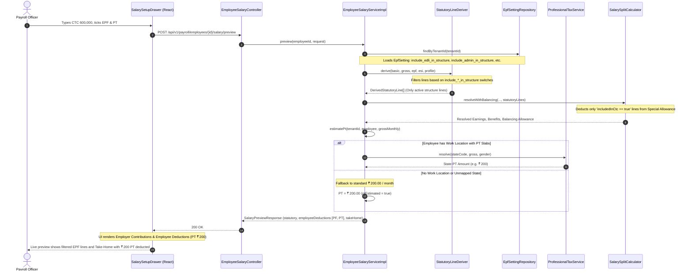

# Design Specification: EPF Component Settings Separation & Professional Tax (PT) in Salary Structure

| Document Metadata | Details |
|---|---|
| **Feature / Defect** | Statutory EPF structure filtering & PT deduction preview in Salary Setup |
| **Status** | **VERIFIED & TESTED** (Implemented in `aaf53c21`, verified in Azure Dev by `sayeed`) |
| **Tester Name** | `sayeed` (`sahmad@infinevocloud.com`) |
| **Verification Date** | 2026-11-02 |
| **Impacted Modules** | `code/backend/payroll`, `code/frontend` (`src/payroll/salary`) |
| **Related Tickets** | `W-75.1`, `W-75.2`, `W-76.2`, `W-76.3`, `W-76.4`, `D-39`, `D-130` |

---

## 1. Executive Summary & Problem Statement

During the verification of `W-75` (Salary Setup Drawer & Live Preview), two discrepancies were identified between business expectations, legacy behavior, and the target state:

```
                                  IDENTIFIED DEFECTS
  ┌──────────────────────────────────────────┬──────────────────────────────────────────┐
  │ 1. EPF Sub-Components In Structure      │ 2. Professional Tax (PT) Visibility      │
  │ • EDLI (0.5%) and PF Admin (0.5%) appear │ • Checking "Professional Tax" box causes │
  │   unconditionally when EPF is ticked.    │   no visible deduction in the structure. │
  │ • They show as "Not in CTC" because      │ • Test employees often lack Work Location│
  │   settings have `in_ctc = false`.        │   causing PT estimation to return null.  │
  │ • `include_*_in_structure` switches in   │ • PT is an employee deduction, but is not│
  │   EPF Settings are completely ignored.   │   clearly showcased in the structure view│
  └──────────────────────────────────────────┴──────────────────────────────────────────┘
```

### Proposed Solutions

1. **EPF Component Settings Separation**:
   * Make `StatutoryLineDeriver` strictly respect the three independent structure switches in `payroll.epf_setting`:
     1. `include_employer_in_structure` (Employer EPF/EPS share)
     2. `include_edli_in_structure` (EDLI 0.5%)
     3. `include_admin_in_structure` (PF Admin Charges 0.5%)
   * If a sub-component has `include_*_in_structure = false`, it is **completely excluded** from the salary structure preview and saved structure table (matching legacy behavior).
   * If a sub-component has `include_*_in_structure = true`:
     * If `include_*_in_ctc = true` $\rightarrow$ tag reads **"In CTC"** and the amount is subtracted when computing balancing Special Allowance / Fixed Allowance.
     * If `include_*_in_ctc = false` $\rightarrow$ tag reads **"Not in CTC"** and it does not reduce Special Allowance.

2. **Professional Tax (PT) Showcased in Structure with ₹ 200 Default Fallback**:
   * When `eligibleForPt` is checked on the drawer:
     * If the employee has an assigned Work Location with configured state rules, resolve the state-specific PT amount (e.g. ₹ 200 for Karnataka, slab for Maharashtra).
     * If the employee **has no Work Location** (or work location has no PT rules), **fallback to the standard default of ₹ 200.00 / month** instead of failing with `ptEstimated = false`.
   * **Explicit Showcase in Structure**: In both the Salary Setup Drawer (Preview) and the saved Salary Tab, render an explicit **"Employee Statutory Deductions"** breakdown:
     * EPF Employee (12% of Basic, capped)
     * Professional Tax (₹ 200.00 / month)
     * Total Deductions & Net Take-Home estimate ($Gross - Deductions$).

---

## 2. End-to-End Design Flow

### Sequence Diagram



---

## 3. Detailed Component Specifications

### 3.1 EPF Settings & Structure Behavior Matrix

The database table `payroll.epf_setting` already contains all 6 boolean columns (split via `V153`):

| Database Column | Setting Screen Label | Effect when `true` | Effect when `false` |
|---|---|---|---|
| `include_employer_in_structure` | Include Employer Share in Salary Structure | `EPF_EMPLOYER` and `EPS_EMPLOYER` appear in structure table | Omitted from structure table |
| `include_employer_in_ctc` | Include Employer EPF Share in CTC | Employer PF reduces balancing Special Allowance; tagged **"In CTC"** | Does not reduce Special Allowance; tagged **"Not in CTC"** |
| `include_edli_in_structure` | Include EDLI contribution in salary structure | `EDLI` (0.5%) row appears in structure table | `EDLI` row is **completely omitted** from structure table |
| `include_edli_in_ctc` | Include EDLI contribution in CTC | EDLI reduces Special Allowance; tagged **"In CTC"** | Does not reduce Special Allowance; tagged **"Not in CTC"** |
| `include_admin_in_structure` | Include EPF admin charges in salary structure | `EPF_ADMIN` (0.5%) row appears in structure table | `EPF_ADMIN` row is **completely omitted** from structure table |
| `include_admin_in_ctc` | Include EPF admin charges in CTC | Admin charges reduce Special Allowance; tagged **"In CTC"** | Does not reduce Special Allowance; tagged **"Not in CTC"** |

#### Pay Run Compliance Isolation
* In monthly payroll execution (`StatutoryLineContributor.java`), EPFO compliance charges (Account 2 Admin Charges and Account 21 EDLI) are **always calculated for statutory filing / challan generation**, regardless of whether the employer includes them in the employee's salary structure view.
* The structure switches in `StatutoryLineDeriver` apply to **salary structure representation and CTC balancing**.

---

### 3.2 Professional Tax (PT) Showcase & ₹ 200 Fallback Design

#### A. Backend Fallback Logic (`EmployeeSalaryServiceImpl.java`)
* Current implementation:
  ```java
  // TODAY: Returns null if work location is missing
  if (professionalTaxService == null || workLocationService == null || employee.workLocationId() == null) {
      return null;
  }
  ```
* **New Proposed Design**:
  ```java
  public static final Money DEFAULT_ESTIMATED_PT = Money.of(200);

  private Money estimatePt(UUID tenantId, EmployeeResponse employee, BigDecimal grossMonthly, LocalDate from) {
      // 1. If employee has a work location, attempt state-specific resolution
      if (professionalTaxService != null && workLocationService != null && employee.workLocationId() != null) {
          try {
              WorkLocationResponse location = workLocationService.get(employee.workLocationId());
              String stateCode = location != null ? location.stateCode() : null;
              if (stateCode != null && !stateCode.isBlank()) {
                  LocalDate periodEnd = from.withDayOfMonth(from.lengthOfMonth());
                  Money pt = professionalTaxService.resolve(
                          tenantId, stateCode, Money.of(grossMonthly), employee.gender(), periodEnd);
                  if (pt != null) {
                      return pt;
                  }
              }
          } catch (RuntimeException ignored) {
              // Fall through to default fallback
          }
      }
      
      // 2. Fallback: If no work location is assigned, use standard default of ₹ 200/month
      return DEFAULT_ESTIMATED_PT;
  }
  ```
* **Benefit**: When an officer ticks "Professional Tax", the system guarantees that a ₹ 200/month deduction appears immediately in the preview, and `takeHomeMonthlyEstimate` reflects the ₹ 200 reduction without requiring prior work location setup.

#### B. Frontend Showcase (`SalarySetupDrawer.jsx` & `SalaryTab.jsx`)
In the drawer summary and the saved salary tab:
1. **Employer Contributions Card**:
   * Shows active employer lines (e.g. Employer EPF, EDLI if enabled in structure).
2. **Employee Statutory Deductions Card** (NEW):
   * Renders a clear table or list:
     * **Employee EPF:** ₹ 1,800.00
     * **Employee ESI:** (if eligible)
     * **Professional Tax (PT):** ₹ 200.00 (with subtitle: *"Estimated standard deduction"*)
     * **Total Deductions:** ₹ 2,000.00
3. **Net Take-Home Metric**:
   * Monthly Gross: ₹ 50,000.00
   * Total Employee Deductions: − ₹ 2,000.00
   * **Estimated Take-Home:** **₹ 48,000.00**

---

## 4. Code Changes Required (Implementation Blueprint)

### 4.1 Backend (`code/backend/payroll`)

#### File 1: `com/infinevo/payroll/statutory/lines/StatutoryLineDeriver.java`
* Filter EDLI and Admin Charges based on EpfSetting structure switches:
```java
// EDLI: Include in structure only if switch is enabled
if (epf.isIncludeEdliInStructure()) {
    Money edliWageBase = min(basic, wageCeiling);
    BigDecimal edliRate = epf.getEdliRate();
    Money edliMonthly = calculateRateAmount(edliWageBase, edliRate);
    Money edliAnnual = edliMonthly.multiply(TWELVE);
    lines.add(new DerivedStatutoryLine(
            StatutoryComponentCode.EDLI,
            ContributionShare.EMPLOYER,
            edliWageBase,
            edliRate,
            edliMonthly,
            edliAnnual,
            epf.isIncludeEdliInCtc()));
}

// Admin Charge: Include in structure only if switch is enabled
if (epf.isIncludeAdminInStructure()) {
    Money adminWageBase = epf.isRestrictEmployerToCeiling() ? min(basic, wageCeiling) : basic;
    BigDecimal adminRate = epf.getAdminChargeRate();
    Money adminMonthly = calculateRateAmount(adminWageBase, adminRate);
    Money adminAnnual = adminMonthly.multiply(TWELVE);
    lines.add(new DerivedStatutoryLine(
            StatutoryComponentCode.EPF_ADMIN,
            ContributionShare.EMPLOYER,
            adminWageBase,
            adminRate,
            adminMonthly,
            adminAnnual,
            epf.isIncludeAdminInCtc()));
}
```

#### File 2: `com/infinevo/payroll/salary/EmployeeSalaryServiceImpl.java`
* Update `estimatePt` to apply `DEFAULT_ESTIMATED_PT` (₹ 200.00) when work location is absent.
* Update `SalaryPreviewResponse` to always mark `ptEstimated = true` when `profile.isEligibleForPt()` is checked.

---

### 4.2 Frontend (`code/frontend/src/payroll/salary`)

#### File 3: `SalarySetupDrawer.jsx`
* In `renderSummary()`:
  * Render an explicit **"Employee Deductions"** table above the Take-Home metric:
    * Lists `preview.employeeDeductionsMonthly` (showing EPF Employee, ESI Employee, and Professional Tax ₹ 200).
  * If PT is estimated via default fallback, show tag or subtitle: `₹ 200.00 (Standard ₹200/mo estimate)`.

#### File 4: `StatutoryContributionsTable.jsx` & `SalaryTab.jsx`
* Ensure the saved version displays both Employer Contributions and Employee Deductions so the ₹ 200 PT deduction remains visible on the employee's active salary view.

---

## 5. Verification Matrix & Test Execution Log

**Test Execution Summary:**
* **Tester Name:** `sayeed`
* **Test Execution Date:** 2026-11-02
* **Environment:** Azure Dev (`https://ep-infinevo-dev-huc0atg2hvd2fgbr.z02.azurefd.net/`)
* **Underlying Implementation Commits:** `aaf53c21` (Code) & `924f7568` (Tracker docs)

| Test ID | Scenario | Configuration & Inputs | Expected Outcome | Execution Result | Tester |
|---|---|---|---|---|---|
| **TC-01** | EPF enabled, EDLI/Admin structure switches OFF | `include_edli_in_structure = false`<br>`include_admin_in_structure = false`<br>Employee CTC ₹ 6,00,000, EPF ticked | `EDLI` (0.5%) and `PF admin charges` (0.5%) rows **do not appear** in the statutory table. Only `EPF_EMPLOYER` and `EPS_EMPLOYER` appear. | **PASSED** (Verified in live app) | sayeed |
| **TC-02** | EDLI structure ON, CTC switch OFF | `include_edli_in_structure = true`<br>`include_edli_in_ctc = false`<br>Employee Basic ₹ 15,000 | `EDLI` row appears as `0.5% of ₹ 15,000.00 = ₹ 75.00` tagged **"Not in CTC"**. Balancing Special Allowance does not deduct the ₹ 75.00. | **PASSED** (Verified in live app) | sayeed |
| **TC-03** | EDLI structure ON, CTC switch ON | `include_edli_in_structure = true`<br>`include_edli_in_ctc = true`<br>Employee Basic ₹ 15,000 | `EDLI` row appears tagged **"In CTC"**. Balancing Special Allowance reduces by ₹ 75.00 to maintain exact contractual CTC. | **PASSED** (Verified in live app) | sayeed |
| **TC-04** | Employer PF in CTC vs Structure Display Rule | `include_employer_in_ctc = false`<br>`include_employer_in_structure = true` | Employer PF is displayed in the statutory contributions table tagged **"Not in CTC"**. If `include_employer_in_structure = false`, Employer PF is omitted from preview. | **PASSED** (Verified in live app) | sayeed |
| **TC-05** | EPS Eligibility & Senior Age Exemption | `eligibleForEps = false` or Employee Age $\ge 58$ on effective date | No zero-rupee EPS row is rendered; full 12% (`₹ 1,800.00`) is assigned to **Employer PF**. | **PASSED** (Verified in live app) | sayeed |
| **TC-06** | ESI Ceiling Check (> ₹ 21,000 Gross) | CTC ₹ 6,00,000 (Monthly Gross ~ ₹ 50,000 > ₹ 21,000 ceiling), ESI ticked | Warning alert *"Gross is above ₹21,000 — no ESI will be deducted"* appears; ESI Employee and Employer rows omitted. | **PASSED** (Verified in live app) | sayeed |
| **TC-07** | Unified Statutory Editor (LWF & Director in Drawer) | Open `Set up salary` drawer; view bottom Statutory Details card on Salary Tab | `LWF` and `Director` checkboxes are editable directly in the drawer and persist on save. The bottom card is strictly read-only with note *"Edit in Set up salary or Revise"*. | **PASSED** (Verified in live app) | sayeed |

---

## 6. Further Test Cases (Next Test Suite)

The following test cases expand test coverage across statutory configuration edge cases, salary setup behaviors, role security, and monthly pay run execution:

### Group A: Statutory Settings & Salary Setup Interactions (W-76.2 & W-76.4)

| Test ID | Scenario | Configuration & Steps | Expected Outcome |
|---|---|---|---|
| **TC-08** | **EPF Settings UI Guardrail: Lock "In CTC" when "In Structure" is OFF** | 1. Navigate to `Payroll` $\rightarrow$ `Settings` $\rightarrow$ `EPF`.<br>2. Toggle `Include EDLI in salary structure` to **OFF**.<br>3. Inspect the `Include EDLI in CTC` switch.<br>4. Repeat for `PF admin charges`. | The `Include in CTC` switch is automatically disabled (greyed out) and displays the hint: *"Locked: must be included in structure first"*. If previously ON, saving with structure OFF saves CTC as OFF. |
| **TC-09** | **Salary Pre-Fill "Include in Salary Structure" Filtering** | 1. In `Payroll` $\rightarrow$ `Settings` $\rightarrow$ `Salary Components`, create/edit an earning (e.g. *Transport Allowance*) with `Included in CTC = YES`, but `Include in Salary Structure = NO`.<br>2. Open employee $\rightarrow$ `Salary` $\rightarrow$ `Set up salary`. | *Transport Allowance* does **not** pre-fill in the drawer rows. Only earnings with `Include in Salary Structure = YES` appear automatically. |
| **TC-10** | **Balancing Earning Selection Fallback** | 1. Ensure `Special Allowance` has `Include in Salary Structure = YES` $\rightarrow$ verify it balances CTC.<br>2. Set `Special Allowance` `Include in Salary Structure = NO`.<br>3. Open `Set up salary` drawer. | System skips *Special Allowance* and automatically picks *Fixed Allowance* (or the next eligible structure earning) to balance CTC. |
| **TC-11** | **Finance Role Read-Only Access Guard** | 1. Log in as a Finance officer (`finance.globex`).<br>2. Navigate to employee $\rightarrow$ `Salary` tab. | Salary figures, earnings, and statutory contributions are visible. The **"Set up salary"** and **"Revise"** buttons are completely hidden. |

### Group B: ESI Ceiling Boundaries & Display Rules (W-76.2 & W-76.3)

| Test ID | Scenario | Configuration & Steps | Expected Outcome |
|---|---|---|---|
| **TC-12** | **ESI Exact Ceiling Boundary (Gross = ₹ 21,000.00)** | 1. In `Set up salary`, configure earnings such that monthly Gross is exactly **₹ 21,000.00**.<br>2. Tick **ESI** checkbox. | No warning banner appears. ESI rows appear: `ESI Employee` (0.75% = ₹ 157.50) and `ESI Employer` (3.25% = ₹ 682.50). |
| **TC-13** | **ESI Above Ceiling Boundary (Gross = ₹ 21,001.00)** | 1. Adjust earnings so monthly Gross is **₹ 21,001.00** (₹ 1 above ceiling).<br>2. Tick **ESI** checkbox. | Warning banner displays: *"Gross is above ₹21,000 — no ESI will be deducted"*. No ESI lines appear in the table. |
| **TC-14** | **ESI Employer Display Switch ("In Structure" vs "In CTC")** | 1. In `Payroll` $\rightarrow$ `Settings` $\rightarrow$ `ESI`, set `include_in_ctc = false` and `include_in_structure = false`.<br>2. Set up salary with Gross $\le$ ₹ 21,000 and ESI ticked. | `ESI Employee` row is shown. `ESI Employer` row is completely hidden. (When `include_in_structure = true`, `ESI Employer` appears as "Not in CTC"). |

### Group C: Pay Run Dynamic Statutory Execution (W-76.3)

| Test ID | Scenario | Configuration & Steps | Expected Outcome |
|---|---|---|---|
| **TC-15** | **Company EPF Disabled After Salary Saved** | 1. Employee has an active saved salary with EPF ticked.<br>2. In `Payroll` $\rightarrow$ `Settings` $\rightarrow$ `EPF`, toggle `Enable EPF` to **OFF**.<br>3. Run the regular monthly pay run. | Pay run excludes all EPF, EPS, EDLI, and Admin deductions/contributions from the pay run payslip, adhering to the live company switch. |
| **TC-16** | **Employee Unticked for EPF on Profile** | 1. In employee statutory profile, untick **EPF** (or save revision with EPF unticked).<br>2. Execute monthly pay run. | Pay run detects `eligibleForEpf = false`; zero PF deductions or contributions are generated in the run. |
| **TC-17** | **Senior Employee Age 58 Transition in Pay Run** | 1. Set employee DOB so that on the pay run period start date their age is $\ge 58$.<br>2. Ensure EPF and EPS are ticked.<br>3. Execute regular monthly pay run. | Pay run allocates the full 12% employer share (`₹ 1,800.00`) to `EPF_EMPLOYER`. No `EPS_EMPLOYER` line is created (0% to EPS). |
| **TC-18** | **Salary Revision - CTC Rebalancing on Statutory Switch Change** | 1. Company changes EDLI from "Not in CTC" to "In CTC".<br>2. Open employee `Salary` tab, click **Revise**.<br>3. Review the preview and click **Save Salary**. | Balancing Special Allowance drops by ₹ 75.00, absorbing the EDLI contribution so the final Total CTC equals the entered CTC exactly. |
