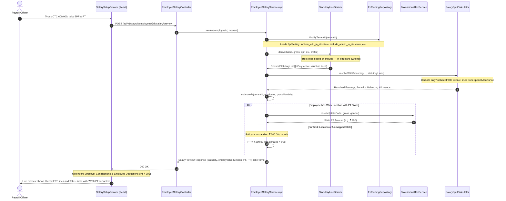

# Design Specification: EPF Component Settings Separation & Professional Tax (PT) in Salary Structure

| Document Metadata | Details |
|---|---|
| **Feature / Defect** | Statutory EPF structure filtering & PT deduction preview in Salary Setup |
| **Status** | **Design / RFC** (Proposed for review before implementation) |
| **Impacted Modules** | `code/backend/payroll`, `code/frontend` (`src/payroll/salary`) |
| **Related Tickets** | `W-75.1`, `W-75.2`, `D-39` (`V153__epf_edli_admin_split.sql`), `D-130` |

---

## 1. Executive Summary & Problem Statement

During the verification of `W-75` (Salary Setup Drawer & Live Preview), two discrepancies were identified between business expectations, legacy behavior, and the target state:

```
                                  IDENTIFIED DEFECTS
  ┌──────────────────────────────────────────┬──────────────────────────────────────────┐
  │ 1. EPF Sub-Components In Structure      │ 2. Professional Tax (PT) Visibility      │
  │ • EDLI (0.5%) and PF Admin (0.5%) appear │ • Checking "Professional Tax" box causes │
  │   unconditionally when EPF is ticked.    │   no visible deduction in the structure. │
  │ • They show as "Not in CTC" because      │ • Test employees often lack Work Location│
  │   settings have `in_ctc = false`.        │   causing PT estimation to return null.  │
  │ • `include_*_in_structure` switches in   │ • PT is an employee deduction, but is not│
  │   EPF Settings are completely ignored.   │   clearly showcased in the structure view│
  └──────────────────────────────────────────┴──────────────────────────────────────────┘
```

### Proposed Solutions

1. **EPF Component Settings Separation**:
   * Make `StatutoryLineDeriver` strictly respect the three independent structure switches in `payroll.epf_setting`:
     1. `include_employer_in_structure` (Employer EPF/EPS share)
     2. `include_edli_in_structure` (EDLI 0.5%)
     3. `include_admin_in_structure` (PF Admin Charges 0.5%)
   * If a sub-component has `include_*_in_structure = false`, it is **completely excluded** from the salary structure preview and saved structure table (matching legacy behavior).
   * If a sub-component has `include_*_in_structure = true`:
     * If `include_*_in_ctc = true` $\rightarrow$ tag reads **"In CTC"** and the amount is subtracted when computing balancing Special Allowance / Fixed Allowance.
     * If `include_*_in_ctc = false` $\rightarrow$ tag reads **"Not in CTC"** and it does not reduce Special Allowance.

2. **Professional Tax (PT) Showcased in Structure with ₹ 200 Default Fallback**:
   * When `eligibleForPt` is checked on the drawer:
     * If the employee has an assigned Work Location with configured state rules, resolve the state-specific PT amount (e.g. ₹ 200 for Karnataka, slab for Maharashtra).
     * If the employee **has no Work Location** (or work location has no PT rules), **fallback to the standard default of ₹ 200.00 / month** instead of failing with `ptEstimated = false`.
   * **Explicit Showcase in Structure**: In both the Salary Setup Drawer (Preview) and the saved Salary Tab, render an explicit **"Employee Statutory Deductions"** breakdown:
     * EPF Employee (12% of Basic, capped)
     * Professional Tax (₹ 200.00 / month)
     * Total Deductions & Net Take-Home estimate ($Gross - Deductions$).

---

## 2. End-to-End Design Flow

### Sequence Diagram



---

## 3. Detailed Component Specifications

### 3.1 EPF Settings & Structure Behavior Matrix

The database table `payroll.epf_setting` already contains all 6 boolean columns (split via `V153`):

| Database Column | Setting Screen Label | Effect when `true` | Effect when `false` |
|---|---|---|---|
| `include_employer_in_structure` | Include Employer Share in Salary Structure | `EPF_EMPLOYER` and `EPS_EMPLOYER` appear in structure table | Omitted from structure table |
| `include_employer_in_ctc` | Include Employer EPF Share in CTC | Employer PF reduces balancing Special Allowance; tagged **"In CTC"** | Does not reduce Special Allowance; tagged **"Not in CTC"** |
| `include_edli_in_structure` | Include EDLI contribution in salary structure | `EDLI` (0.5%) row appears in structure table | `EDLI` row is **completely omitted** from structure table |
| `include_edli_in_ctc` | Include EDLI contribution in CTC | EDLI reduces Special Allowance; tagged **"In CTC"** | Does not reduce Special Allowance; tagged **"Not in CTC"** |
| `include_admin_in_structure` | Include EPF admin charges in salary structure | `EPF_ADMIN` (0.5%) row appears in structure table | `EPF_ADMIN` row is **completely omitted** from structure table |
| `include_admin_in_ctc` | Include EPF admin charges in CTC | Admin charges reduce Special Allowance; tagged **"In CTC"** | Does not reduce Special Allowance; tagged **"Not in CTC"** |

#### Pay Run Compliance Isolation
* In monthly payroll execution (`StatutoryLineContributor.java`), EPFO compliance charges (Account 2 Admin Charges and Account 21 EDLI) are **always calculated for statutory filing / challan generation**, regardless of whether the employer includes them in the employee's salary structure view.
* The structure switches in `StatutoryLineDeriver` apply to **salary structure representation and CTC balancing**.

---

### 3.2 Professional Tax (PT) Showcase & ₹ 200 Fallback Design

#### A. Backend Fallback Logic (`EmployeeSalaryServiceImpl.java`)
* Current implementation:
  ```java
  // TODAY: Returns null if work location is missing
  if (professionalTaxService == null || workLocationService == null || employee.workLocationId() == null) {
      return null;
  }
  ```
* **New Proposed Design**:
  ```java
  public static final Money DEFAULT_ESTIMATED_PT = Money.of(200);

  private Money estimatePt(UUID tenantId, EmployeeResponse employee, BigDecimal grossMonthly, LocalDate from) {
      // 1. If employee has a work location, attempt state-specific resolution
      if (professionalTaxService != null && workLocationService != null && employee.workLocationId() != null) {
          try {
              WorkLocationResponse location = workLocationService.get(employee.workLocationId());
              String stateCode = location != null ? location.stateCode() : null;
              if (stateCode != null && !stateCode.isBlank()) {
                  LocalDate periodEnd = from.withDayOfMonth(from.lengthOfMonth());
                  Money pt = professionalTaxService.resolve(
                          tenantId, stateCode, Money.of(grossMonthly), employee.gender(), periodEnd);
                  if (pt != null) {
                      return pt;
                  }
              }
          } catch (RuntimeException ignored) {
              // Fall through to default fallback
          }
      }
      
      // 2. Fallback: If no work location is assigned, use standard default of ₹ 200/month
      return DEFAULT_ESTIMATED_PT;
  }
  ```
* **Benefit**: When an officer ticks "Professional Tax", the system guarantees that a ₹ 200/month deduction appears immediately in the preview, and `takeHomeMonthlyEstimate` reflects the ₹ 200 reduction without requiring prior work location setup.

#### B. Frontend Showcase (`SalarySetupDrawer.jsx` & `SalaryTab.jsx`)
In the drawer summary and the saved salary tab:
1. **Employer Contributions Card**:
   * Shows active employer lines (e.g. Employer EPF, EDLI if enabled in structure).
2. **Employee Statutory Deductions Card** (NEW):
   * Renders a clear table or list:
     * **Employee EPF:** ₹ 1,800.00
     * **Employee ESI:** (if eligible)
     * **Professional Tax (PT):** ₹ 200.00 (with subtitle: *"Estimated standard deduction"*)
     * **Total Deductions:** ₹ 2,000.00
3. **Net Take-Home Metric**:
   * Monthly Gross: ₹ 50,000.00
   * Total Employee Deductions: − ₹ 2,000.00
   * **Estimated Take-Home:** **₹ 48,000.00**

---

## 4. Code Changes Required (Implementation Blueprint)

### 4.1 Backend (`code/backend/payroll`)

#### File 1: `com/infinevo/payroll/statutory/lines/StatutoryLineDeriver.java`
* Filter EDLI and Admin Charges based on EpfSetting structure switches:
```java
// EDLI: Include in structure only if switch is enabled
if (epf.isIncludeEdliInStructure()) {
    Money edliWageBase = min(basic, wageCeiling);
    BigDecimal edliRate = epf.getEdliRate();
    Money edliMonthly = calculateRateAmount(edliWageBase, edliRate);
    Money edliAnnual = edliMonthly.multiply(TWELVE);
    lines.add(new DerivedStatutoryLine(
            StatutoryComponentCode.EDLI,
            ContributionShare.EMPLOYER,
            edliWageBase,
            edliRate,
            edliMonthly,
            edliAnnual,
            epf.isIncludeEdliInCtc()));
}

// Admin Charge: Include in structure only if switch is enabled
if (epf.isIncludeAdminInStructure()) {
    Money adminWageBase = epf.isRestrictEmployerToCeiling() ? min(basic, wageCeiling) : basic;
    BigDecimal adminRate = epf.getAdminChargeRate();
    Money adminMonthly = calculateRateAmount(adminWageBase, adminRate);
    Money adminAnnual = adminMonthly.multiply(TWELVE);
    lines.add(new DerivedStatutoryLine(
            StatutoryComponentCode.EPF_ADMIN,
            ContributionShare.EMPLOYER,
            adminWageBase,
            adminRate,
            adminMonthly,
            adminAnnual,
            epf.isIncludeAdminInCtc()));
}
```

#### File 2: `com/infinevo/payroll/salary/EmployeeSalaryServiceImpl.java`
* Update `estimatePt` to apply `DEFAULT_ESTIMATED_PT` (₹ 200.00) when work location is absent.
* Update `SalaryPreviewResponse` to always mark `ptEstimated = true` when `profile.isEligibleForPt()` is checked.

---

### 4.2 Frontend (`code/frontend/src/payroll/salary`)

#### File 3: `SalarySetupDrawer.jsx`
* In `renderSummary()`:
  * Render an explicit **"Employee Deductions"** table above the Take-Home metric:
    * Lists `preview.employeeDeductionsMonthly` (showing EPF Employee, ESI Employee, and Professional Tax ₹ 200).
  * If PT is estimated via default fallback, show tag or subtitle: `₹ 200.00 (Standard ₹200/mo estimate)`.

#### File 4: `StatutoryContributionsTable.jsx` & `SalaryTab.jsx`
* Ensure the saved version displays both Employer Contributions and Employee Deductions so the ₹ 200 PT deduction remains visible on the employee's active salary view.

---

## 5. Verification Matrix & Test Plan

| Test ID | Scenario | Configuration | Expected Outcome |
|---|---|---|---|
| **TC-01** | EPF enabled, EDLI/Admin structure switches OFF | `include_edli_in_structure = false`<br>`include_admin_in_structure = false` | EDLI and PF admin rows **do not appear** in the statutory table. Only `EPF_EMPLOYER` and `EPS_EMPLOYER` appear. |
| **TC-02** | EDLI structure ON, CTC switch OFF | `include_edli_in_structure = true`<br>`include_edli_in_ctc = false` | EDLI row appears with tag **"Not in CTC"**. Balancing Special Allowance does not deduct the ₹ 62.50. |
| **TC-03** | EDLI structure ON, CTC switch ON | `include_edli_in_structure = true`<br>`include_edli_in_ctc = true` | EDLI row appears with tag **"In CTC"**. Balancing Special Allowance reduces by ₹ 62.50 to maintain exact CTC. |
| **TC-04** | PT checked (Employee with Work Location) | Karnataka location, Gross > ₹ 15,000 | PT resolves to ₹ 200.00. Take-home drops by ₹ 200.00. |
| **TC-05** | PT checked (Employee without Work Location) | `workLocationId = null` | PT resolves to fallback ₹ 200.00. Take-home drops by ₹ 200.00. No error message shown. |
| **TC-06** | PT unchecked | `eligibleForPt = false` | PT deduction is ₹ 0. Take-home reflects gross minus PF only. |

---

## 6. Review & Next Steps

Please review this design flow. Once approved, the implementation order will be:
1. Update `StatutoryLineDeriver.java` to condition EDLI and EPF Admin lines on `include_*_in_structure`.
2. Add the ₹ 200 PT fallback in `EmployeeSalaryServiceImpl.java:estimatePt()`.
3. Enhance the Salary Setup Drawer preview and Salary Tab to showcase Employee Statutory Deductions (including PT).
4. Run unit and integration tests (`StatutoryLineDeriverTest`, `EmployeeSalaryServiceTest`, `SalarySetupDrawer.test.jsx`).
