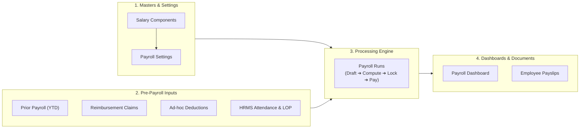

# End-to-End Payroll Operations & Compliance
## Role Demo: Payroll Officer
### Infinevo Cloud HCM Suite

**Presenter:** Payroll Officer  
**Audience:** Leadership, HR Executives, Finance & Audit Teams  
**Theme:** Accuracy, Multi-State Statutory Compliance, and Zero-Spreadsheet Automation

---

## Executive Agenda: The 7 Core Payroll Tabs

1. **Payroll Dashboard** — Real-time operational KPIs & statutory liability summary
2. **Payroll Runs** — Monthly compute lifecycle, line-item audits, off-cycle runs & payslips
3. **Prior Payroll** — Mid-year onboarding import & annual tax continuity
4. **Reimbursement Claims** — Receipt verification & automated payroll integration
5. **Deductions** — One-time & recurring advance/asset recoveries
6. **Payroll Settings** — Pay schedule policies, EPF, ESI & multi-state PT configuration
7. **Salary Components** — Earnings catalogue, statutory tags & compensation structuring

---

## The End-to-End Monthly Payroll Flow



---

## Tab 1: Payroll Dashboard
### The Operations Command Center & Compliance Briefing

#### 🎯 Purpose
The first screen the Payroll Officer consults every morning to track cycle progress, headcount readiness, and statutory dues before pay day.

#### 🖥️ Key Screen Elements
* **Active Cycle Card:** Shows current pay period, disbursement total (e.g. ₹42.5L), cycle status (`Draft`, `Locked`, `Paid`), and employee count.
* **Payroll Headcount Card:** Active employees on payroll vs. newly joined unassigned profiles needing compensation assignment.
* **Statutory Liability Tiles:** Instant summary totals for **EPF**, **ESI**, **Professional Tax (PT)**, and **TDS** (Income Tax).
* **FY Trend Table:** Month-over-month Gross Pay, Deductions, and Net Pay trends across the financial year.

#### 🎙️ Live Demo Script
> *"Welcome to the Payroll Dashboard. As a Payroll Officer, this is my single source of truth. At a glance, I know our October net liability is ₹42.5 Lakhs across 142 employees. The statutory tiles give me immediate visibility into our liability for PF, ESI, and TDS before filing monthly returns. If any new joiners lack salary assignments, the headcount card flags them immediately so no one is left out of the payroll cutoff."*

---

## Tab 2: Payroll Runs
### The Core Execution Engine & Line-Item Audit

#### 🎯 Purpose
Where the actual calculation, audit verification, lock-down, payment disbursement, and employee payslip distribution happen.

#### 🖥️ Key Screen Elements
* **Lifecycle State Machine:**  
  `Draft` ➔ `Compute` ➔ `Lock` ➔ `Approve` ➔ `Record Payment` ➔ `Publish Payslips`
* **Employee Line-Items Drawer:** Click into any employee for full transparency:
  * Earnings (Basic, HRA, Allowances, LOP loss-of-pay deductions)
  * Statutory deductions (EPF 12%, ESI 0.75%, Professional Tax)
  * Income Tax (auto-computed monthly TDS)
  * Ad-hoc deductions and approved claims
* **Off-Cycle Pay Runs:** Ability to run bonuses, salary arrears, or Full & Final (F&F) settlements without disturbing the main monthly cycle.

#### 🎙️ Live Demo Script
> *"This is the core engine. When we trigger 'Compute', the system pulls attendance and LOP days from HRMS, approved claims, and deductions in seconds. By opening an employee's line item, both the Payroll Officer and internal auditors can inspect exact gross-to-net formulas. Once verified, the run is locked to freeze data, approved, and payslips are published directly to employee self-service portals."*

---

## Tab 3: Prior Payroll
### Mid-Year Onboarding & Historical Tax Continuity

#### 🎯 Purpose
Ensures accurate tax deduction and seamless mid-year migration when a company or employee joins mid-financial year (e.g., October in FY 2026–27).

#### 🖥️ Key Screen Elements
* **Excel / CSV Bulk Importer:** Bulk upload past months' earnings, TDS deducted, EPF, and ESI.
* **YTD Tax Continuity:** Feeds past earnings into the annual tax computation engine so employees are not over-taxed or double-taxed.
* **Form 16 Continuity:** Ensures quarterly 24Q filings and end-of-year Form 16 Part B reflect the full 12-month financial year seamlessly.

#### 🎙️ Live Demo Script
> *"A frequent challenge in payroll transitions is mid-year onboarding. If a client migrates in October, the Prior Payroll module allows us to import April–September historical pay registers via our standardized Excel template. The engine seamlessly absorbs prior earnings and taxes paid, ensuring October's TDS deductions and March's Form 16 are 100% compliant."*

---

## Tab 4: Reimbursement Claims
### Expense Claims Verification & Automated Payout

#### 🎯 Purpose
Centralized queue to audit, approve, or reject employee expense receipts and Flexible Benefit Plan (FBP) claims before payroll cutoff.

#### 🖥️ Key Screen Elements
* **Claim Review Queue:** Filter claims by Status (`Submitted`, `Approved`, `Rejected`, `Paid`), category (Travel, Medical, Food, Books), or Employee.
* **Document Audit:** Side-by-side inspection of uploaded vouchers/bills against claimed and approved amounts.
* **Automatic Payroll Integration:** Approved claims are automatically added to the upcoming pay run as non-taxable / taxable payouts without spreadsheet exports.

#### 🎙️ Live Demo Script
> *"Employees submit claims through their self-service portal with supporting bills. In this tab, I review incoming claims. I can inspect the receipt, adjust the approved amount if a bill doesn't meet company policy, and approve it. Once approved, the claim automatically routes into the next pay run computation as a non-taxable addition."*

---

## Tab 5: Deductions
### Ad-Hoc & Scheduled Salary Recoveries

#### 🎯 Purpose
Management of company-specific deductions outside statutory rules (e.g., salary advances, asset damages, loan repayments, company dues).

#### 🖥️ Key Screen Elements
* **One-Time vs. Recurring Deductions:**
  * **One-Time:** Single cycle recovery (e.g., lost security badge, notice pay recovery).
  * **Recurring:** Scheduled installment recovery across multiple months (e.g., 6-month festival advance).
* **Deduction Ledger:** Full audit log showing employee, category, amount, effective pay periods, and outstanding balances.
* **Net Pay Protection:** Automated application during pay run compute before net pay generation.

#### 🎙️ Live Demo Script
> *"Whenever an employee receives a salary advance or has a recovery deduction, we record it here. We can set it as a one-time deduction for this month or schedule it across multiple installments. The pay run engine checks this ledger on compute date and applies the deduction directly to the payslip."*

---

## Tab 6: Payroll Settings
### Schedule Policies & Multi-State Statutory Compliance

#### 🎯 Purpose
Defines company pay policies, pay cycles, and multi-state statutory registrations to ensure 100% legal compliance and avoid penalties.

#### 🖥️ Key Sub-Tabs
* **Pay Schedule:** Monthly cycle dates, calculation basis (Calendar days vs. Fixed 30 days vs. Working days), and attendance cutoff date.
* **EPF Settings:** Organization PF registration code, mandatory ₹15,000 wage ceiling capping switch, admin charges, EDLI charges, and employer PF inclusion in CTC.
* **ESI Settings:** ESI code, wage threshold rule (Gross ≤ ₹21,000), 0.75% employee contribution, and 3.25% employer contribution.
* **Professional Tax (PT):** Multi-state PT registration and slab matrices (e.g., Karnataka, Maharashtra, Telangana, West Bengal) including automated February slab variations.

#### 🎙️ Live Demo Script
> *"This tab protects the organization from non-compliance penalties. In Payroll Settings, we configure our schedule and statutory registrations. Notice the multi-state PT support: if an employee works out of Mumbai, Maharashtra slabs apply; if in Bengaluru, Karnataka slabs apply automatically. Our EPF settings enforce statutory caps so you never overpay or underpay statutory bodies."*

---

## Tab 7: Salary Components
### Master Earnings Catalogue & Compensation Architecture

#### 🎯 Purpose
The foundational building blocks of employee compensation structures (CTC templates, statutory tags, and earnings categories).

#### 🖥️ Key Screen Elements
* **Earnings Catalogue:** Pre-configured and custom earnings (Basic, HRA, Dearness Allowance, Special Allowance, Conveyance, Medical, Performance Bonus).
* **Flexible Calculation Rules:** Fixed monthly amount, percentage of Basic, or dynamic formula.
* **Statutory Consideration Checkboxes:**
  * Tax-exempt section rules (e.g., Section 10(13A) for HRA).
  * Consideration checkboxes for **EPF wage**, **ESI wage**, and **Gratuity**.
* **Fixed vs. Variable:** Cleanly separates guaranteed monthly CTC from performance incentives.

#### 🎙️ Live Demo Script
> *"Finally, the Salary Components tab is where we define how compensation is structured. We can create custom allowances or use industry standards. For each component, we configure whether it attracts PF, whether it is taxable, and whether it's part of CTC. When HR creates an employee salary, these components dynamically calculate the monthly breakdown."*

---

## Executive Demo Storyline: Recommended Presentation Flow

```
Step 1: The Setup (Tabs 7 & 6)
   ↳ Show Salary Components & Payroll Settings to establish compliance guardrails.

Step 2: Pre-Payroll Inputs (Tabs 3, 4 & 5)
   ↳ Show Prior Payroll (YTD), Reimbursement Claims approval, and Deductions.

Step 3: The Execution (Tab 2)
   ↳ Run "Compute" in Payroll Runs, inspect an employee line item, Lock & Approve.

Step 4: The Result (Tab 1)
   ↳ Return to Payroll Dashboard to review updated metrics, payout totals, and payslips.
```

---

## Demo Q&A & Objection Handling Cheat Sheet

| Question from Client / Auditor | Winning Answer |
|---|---|
| **"Can we re-run payroll if attendance changes late?"** | **Yes.** As long as the pay run is in `Draft` or `Computed` status, you can update inputs and click **Re-compute**. Once `Locked`, it is frozen for audit. |
| **"How are mid-month joiners or exits handled?"** | The pay run engine automatically prorates days based on the configured **Pay Schedule basis** (e.g., calendar days) and factors in loss-of-pay. |
| **"Does the platform support both Old and New Tax Regimes?"** | **Yes.** Employees choose their regime, submit declarations (80C, 80D, HRA), and the engine computes monthly TDS automatically. |
| **"Can we run an off-cycle bonus without affecting regular payroll?"** | **Yes.** The **Off-Cycle Pay Run** feature allows bonus or arrears disbursement with separate tax handling and payslips. |
| **"Are generated payslips secure?"** | **Yes.** Payslips are generated as secure, tamper-proof PDFs with password protection and delivered instantly to employee self-service. |

---

## Summary & Closing Slide

### Why Infinevo Payroll Delivers Total Confidence

* ⚡ **Speed:** Compute hundreds of employee salaries in seconds.
* 🛡️ **Zero Non-Compliance:** Automated statutory updates for EPF, ESI, PT, and TDS.
* 🔍 **Audit Readiness:** Transparent gross-to-net calculation drawers with full revision history.
* 📱 **Employee Delight:** Digital claims, investment declaration workflows, and instant payslips.

**Thank you! Open for Questions.**
