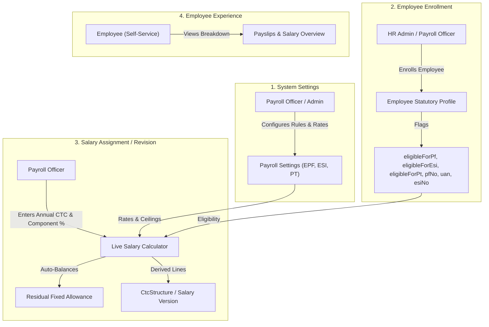

# Statutory Components & Salary Structure Auto-Adjustment Design Specification

**Document Version:** 1.0  
**Status:** PROPOSED ARCHITECTURAL DESIGN  
**Date:** 2026-10-29  
**Author:** DeepMind Antigravity Pair Programming Team  
**Audience:** Payroll Officers, HR Administrators, Engineering & QA Teams  

---

## 1. Executive Summary & Core Objectives

In the legacy HRMS application (`legacy/Payroll-Fend-react`), statutory configurations (such as EPF 12%, EDLI 0.50%, Admin Charges 0.50%, and ESI 3.25%) were **hardcoded** inside frontend form handlers (`salaryDetails.js` and `editSalaryRevision.js`). Furthermore, when entering an employee's Annual CTC and adjusting earning percentages (Basic, HRA, Conveyance), the residual **Fixed Allowance** auto-adjusted dynamically to maintain exact CTC reconciliation.

In the target HCM platform:
1. We already have **dynamic, tenant-configurable statutory settings** for EPF, ESI, and PT (`/payroll/settings/epf`, `/payroll/settings/esi`, `/payroll/settings/professional-tax`).
2. We already have an **Employee Statutory Profile** card on the salary page (`StatutoryProfileCard.jsx`).
3. We already have a pure backend mathematical engine ([`StatutoryLineDeriver.java`](file:///d:/Workspace/infinevo-platform/code/backend/payroll/src/main/java/com/infinevo/payroll/statutory/lines/StatutoryLineDeriver.java)) that derives statutory lines from dynamic settings.

However, the **Salary Structure Assignment and Revision screen** (`SalaryVersionForm.jsx`) and the **Active Salary Structure View** (`SalaryTab.jsx`) currently do not expose these statutory lines, nor do they run the live auto-balancing residual calculation during CTC adjustments.

### Objectives of this Design:
- **Zero Hardcoding**: Every rate (EPF, EPS, EDLI, Admin, ESI, PT), wage ceiling, and CTC inclusion rule is dynamically driven by tenant settings.
- **Role-Based Workflows**: Clear role segregation for who configures settings, who enrolls employees, and who views breakdowns.
- **Real-Time Live Auto-Balancing**: Instantaneous recalculation of the residual earning component (e.g. Fixed Allowance) as the user types Annual CTC or adjusts component percentages/flat amounts.
- **End-to-End Consistency**: The exact same calculation executed live in the UI draft is validated by the backend CTC reconciliation and deducted accurately during monthly Pay Runs.

---

## 2. Current State vs. Target State (Comprehensive Gap Analysis)

| Module / Component | Legacy System Behavior | Current HCM Platform Status | Target Design Requirement |
|---|---|---|---|
| **1. Statutory Settings** | Hardcoded rates across frontend files (e.g. `basicMonthly * 12 / 100`, ₹482 ESI). | **Implemented**: Dynamic entities and APIs for EPF (`EpfSetting`), ESI (`EsiSetting`), and PT (`ProfessionalTaxService`). | Consume these tenant settings dynamically in salary structure calculations. |
| **2. Employee Statutory Profile** | Demographic form (`basicDetails.js`) captured checkboxes and numbers directly in `basic_details`. | **Implemented**: `EmployeeStatutoryProfile` entity, `StatutoryProfileCard.jsx` on `/payroll/employees/:id/salary`. | 1. Add input length validation (`D-132`).<br>2. Expose statutory enrollment during onboarding (`EmployeeCreate.jsx`). |
| **3. Salary Assignment / Revision Modal** | `salaryDetails.js` and `editSalaryRevision.js` calculated live EPF/ESI employer benefits and auto-adjusted Fixed Allowance. | **Missing**: `SalaryVersionForm.jsx` only accepts raw numbers for Earnings, Benefits, Reimbursements. Zero statutory preview. | Implement dynamic statutory benefit calculation and auto-balancing residual Fixed Allowance. |
| **4. Active Structure View** | Displayed Benefits / Statutory Contributions table with employer shares and rates. | **Missing**: `SalaryTab.jsx` ignores `currentVersion.statutory` and only displays Earnings, Benefits, Reimbursements. | Add **Statutory Contributions** table (`table-salary-statutory`) mapping `currentVersion.statutory`. |
| **5. Pay Run Engine** | Deducted PT and PF based on basic details. | **Implemented**: `StatutoryLineContributor.java` and `StructureLineContributor.java` compute pay lines. | Completely aligned once salary version contains correct statutory lines. |

---

## 3. Settings-Driven Configuration Pattern (No Hardcoding)

Unlike legacy, the platform must never hardcode percentages. All statutory parameters are configured by **Payroll Administrators** under **Payroll Settings**:

### 3.1 EPF Settings (`/payroll/settings/epf`)
- **API Endpoint**: `GET /api/v1/payroll/settings/epf`
- **Dynamic Configurable Parameters**:
  * `enabled`: Master toggle for Provident Fund.
  * `wageCeiling`: Maximum wage base for mandatory PF (default: ₹15,000.00).
  * `restrictEmployeeToCeiling`: Whether Employee PF is capped at the wage ceiling or computed on actual Basic.
  * `restrictEmployerToCeiling`: Whether Employer PF is capped at the wage ceiling.
  * `employeeRate`: Configurable employee deduction rate (default: `12.00%`).
  * `employerRate`: Total employer contribution rate (default: `12.00%`).
  * `epsRate`: Employer pension rate carved out of employer share (default: `8.33%`, senior age cap: 58 years).
  * `edliRate`: EDLI rate (default: `0.50%`, monthly cap ₹75.00).
  * `adminChargeRate`: Admin charges rate (default: `0.50%`).
  * `includeEmployerInCtc`: Boolean flag &mdash; whether Employer EPF/EPS is factored into CTC.
  * `includeEdliInCtc`: Boolean flag &mdash; whether EDLI is factored into CTC.
  * `includeAdminInCtc`: Boolean flag &mdash; whether Admin Charges are factored into CTC.

### 3.2 ESI Settings (`/payroll/settings/esi`)
- **API Endpoint**: `GET /api/v1/payroll/settings/esi`
- **Dynamic Configurable Parameters**:
  * `enabled`: Master toggle for State Insurance.
  * `wageCeiling`: Eligibility gross threshold (default: ₹21,000.00 / month).
  * `employeeRate`: Employee deduction rate (default: `0.75%` of gross).
  * `employerRate`: Employer contribution rate (default: `3.25%` of gross).
  * `includeEmployerInCtc`: Boolean flag &mdash; whether Employer ESI is factored into CTC.

### 3.3 Professional Tax Settings (`/payroll/settings/professional-tax`)
- **API Endpoint**: `GET /api/v1/payroll/settings/professional-tax`
- **Dynamic Parameters**:
  * Resolved automatically by the employee's assigned **Work Location State**.
  * Dynamic slab table (Gross Range Min - Max &rarr; Monthly Tax Amount, with custom month rules e.g. Feb ₹300 in Maharashtra).
  * Governed as an **Employee Deduction**, not an employer CTC component.

---

## 4. Role & Availability Matrix



### Role Access Definitions:
| Role | Allowed Actions | Screens Accessible |
|---|---|---|
| **Payroll Officer** (`payroll.salary.manage`, `payroll.settings.manage`) | Full read/write access: configure statutory settings, update employee statutory profiles, assign initial salaries, execute salary revisions, run payroll. | `/payroll/settings/*`, `/payroll/employees/:id/salary`, `/employees/create` |
| **HR Administrator** (`core.employee.create`, `core.employee.update`) | Enrolls employees in statutory schemes during onboarding, captures PF Account No, UAN, ESI Insurance No. | `/employees/create`, `/employees/:id` |
| **Employee (Self-Service)** (`payroll.salary.read`, `core.employee.read`) | Read-only visibility: views active salary breakdown, statutory contribution lines, deductions, and monthly payslips. | `/me/profile`, `/me/payslips` |

---

## 5. End-to-End Calculation & Auto-Adjustment Engine

### 5.1 The Master CTC Formula
The salary structure reconciles under the foundational rule:
$$\text{Annual CTC} = \text{Total Gross Earnings} + \text{Total Employer Statutory Contributions (in CTC)} + \text{Reimbursements}$$

Where:
1. **Total Gross Earnings** = $\text{Basic} + \text{HRA} + \text{Conveyance} + \dots + \text{Fixed Allowance (Residual)}$
2. **Total Employer Statutory Contributions (in CTC)** = $\text{Employer PF/EPS} + \text{EDLI (if in CTC)} + \text{EPF Admin (if in CTC)} + \text{Employer ESI (if in CTC)}$
3. **Fixed Allowance (Auto-Balanced Residual)**:
$$\text{Fixed Allowance} = \text{Annual CTC} - \sum(\text{Explicit Earnings}) - \text{Total Statutory Contributions in CTC}$$

---

### 5.2 Step-by-Step Mathematical Walkthrough

#### Scenario:
- **Employee Annual CTC**: ₹6,00,000 (Monthly CTC = ₹50,000.00)
- **Employee Statutory Profile**: `eligibleForPf: true`, `eligibleForEsi: true`, `eligibleForPt: true`, `eligibleForEps: true`
- **Tenant EPF Settings**:
  * Wage Ceiling = ₹15,000.00
  * `restrictEmployerToCeiling: true`
  * `employerRate`: 12.00% (EPS = 8.33%, PF = 3.67%)
  * `edliRate`: 0.50% (`includeEdliInCtc: true`)
  * `adminChargeRate`: 0.50% (`includeAdminInCtc: true`)
  * Total ER EPF Package = 13.00% of wage base
- **Tenant ESI Settings**: Wage ceiling = ₹21,000.00 / month, `employerRate`: 3.25%
- **Component Inputs**:
  * Basic = **50% of CTC**
  * HRA = **50% of Basic**

---

#### Step 1: Compute Primary Earnings
$$\text{Basic Annual} = ₹6,00,000 \times 50\% = ₹3,00,000.00 \quad (\text{Monthly} = ₹25,000.00)$$
$$\text{HRA Annual} = ₹3,00,000 \times 50\% = ₹1,50,000.00 \quad (\text{Monthly} = ₹12,500.00)$$
$$\text{Explicit Subtotal Annual} = ₹3,00,000 + ₹1,50,000 = ₹4,50,000.00 \quad (\text{Monthly} = ₹37,500.00)$$

---

#### Step 2: Compute Employer Statutory Contributions (Benefits)
1. **Provident Fund Wage Base**:
   Since $\text{Basic Monthly} (₹25,000) > \text{Ceiling} (₹15,000)$ and `restrictEmployerToCeiling = true`:
   $$\text{PF Wage Base} = ₹15,000.00 / \text{month}$$
2. **Employer EPF Line**:
   $$\text{Employer EPS (8.33\%)} = ₹15,000 \times 8.33\% = ₹1,249.50 / \text{mo} \rightarrow ₹14,994.00 / \text{yr}$$
   $$\text{Employer PF (3.67\%)} = ₹15,000 \times 3.67\% = ₹550.50 / \text{mo} \rightarrow ₹6,606.00 / \text{yr}$$
   $$\text{Subtotal Employer PF/EPS} = ₹1,800.00 / \text{mo} \rightarrow ₹21,600.00 / \text{yr}$$
3. **EDLI & Admin Charges**:
   $$\text{EDLI (0.50\%)} = \min(₹15,000 \times 0.50\%, ₹75) = ₹75.00 / \text{mo} \rightarrow ₹900.00 / \text{yr}$$
   $$\text{EPF Admin (0.50\%)} = ₹15,000 \times 0.50\% = ₹75.00 / \text{mo} \rightarrow ₹900.00 / \text{yr}$$
   $$\text{Total Employer EPF Package} = ₹1,800 + ₹75 + ₹75 = ₹1,950.00 / \text{mo} \rightarrow ₹23,400.00 / \text{yr}$$
4. **ESI Liability**:
   $$\text{Estimated Gross Monthly} \approx \text{Basic} + \text{HRA} = ₹37,500.00$$
   Since $₹37,500.00 > ₹21,000.00 (\text{ESI Ceiling})$, the employee is **Exempt from ESI**:
   $$\text{ESI Employer Contribution} = ₹0.00$$

$$\text{Total Employer Statutory Benefits Included in CTC} = ₹23,400.00 / \text{year} \quad (₹1,950.00 / \text{month})$$

---

#### Step 3: Auto-Calculate Residual Fixed Allowance
$$\text{Fixed Allowance Annual} = \text{Annual CTC} - \text{Basic} - \text{HRA} - \text{Total Statutory Benefits}$$
$$\text{Fixed Allowance Annual} = ₹6,00,000 - ₹3,00,000 - ₹1,50,000 - ₹23,400 = \mathbf{₹1,26,600.00 / \text{year}}$$
$$\text{Fixed Allowance Monthly} = \frac{₹1,26,600.00}{12} = \mathbf{₹10,550.00 / \text{month}}$$

---

#### Step 4: Full Reconciliation Verification
| Component Name | Category | Share / Basis | Monthly (₹) | Annual (₹) | In CTC? |
|---|---|---|---|---|---|
| **Basic Salary** | Earning | 50% of CTC | 25,000.00 | 3,00,000.00 | Yes |
| **House Rent Allowance (HRA)** | Earning | 50% of Basic | 12,500.00 | 1,50,000.00 | Yes |
| **Fixed Allowance (Residual)** | Earning | Auto-Adjusted | **10,550.00** | **1,26,600.00** | Yes |
| **EPF - Employer Contribution** | Benefit (Statutory) | 3.67% of ₹15,000 | 550.50 | 6,606.00 | Yes |
| **EPS - Employer Contribution** | Benefit (Statutory) | 8.33% of ₹15,000 | 1,249.50 | 14,994.00 | Yes |
| **EDLI Contribution** | Benefit (Statutory) | 0.50% of ₹15,000 | 75.00 | 900.00 | Yes |
| **EPF Admin Charges** | Benefit (Statutory) | 0.50% of ₹15,000 | 75.00 | 900.00 | Yes |
| **ESI - Employer Contribution** | Benefit (Statutory) | Exempt (> ₹21k) | 0.00 | 0.00 | Yes |
| **Total Cost to Company (CTC)** | **Total** | **Reconciled** | **₹50,000.00** | **₹6,00,000.00** | &check; **100% Match** |

---

### 5.3 Dynamic Rebalancing Behavior (When User Changes Inputs)

```
User Action: Changes Basic from 50% to 40% (₹2,40,000)
    │
    ├──> Basic = ₹2,40,000 (₹20,000/mo)
    ├──> HRA (50% of Basic) = ₹1,20,000 (₹10,000/mo)
    ├──> Statutory Benefits recalculate:
    │      Basic (₹20,000) still > ₹15,000 ceiling, so PF Package remains ₹23,400
    └──> Fixed Allowance automatically recalculates:
           Fixed Allowance = ₹6,00,000 - ₹2,40,000 - ₹1,20,000 - ₹23,400 = ₹2,16,600 (₹18,050/mo)
```

#### Deficit / Overflow Guard:
If the user manually sets Flat Amounts or percentages such that $\sum(\text{Explicit Components}) > \text{Annual CTC}$:
1. Residual `Fixed Allowance` evaluates to a negative number ($< 0$).
2. The UI immediately highlights the Fixed Allowance row in red:
   `Fixed Allowance: -₹15,000.00 (Exceeds CTC)`.
3. An alert banner appears: *"Total components exceed the Annual CTC by ₹15,000.00. Please reduce Basic, HRA, or flat components before saving."*
4. The **"Save Structure"** button is disabled until components reconcile within $\pm ₹2.00$ tolerance.

---

## 6. Implementation Architecture & Code Blueprint

### 6.1 Architecture Overview

```
┌─────────────────────────────────────────────────────────────┐
│                       Frontend (UI)                         │
│                                                             │
│  ┌───────────────────────┐       ┌───────────────────────┐  │
│  │ SalaryVersionForm.jsx │       │    SalaryTab.jsx      │  │
│  │ (Assignment/Revision) │       │   (Active Overview)   │  │
│  └───────────┬───────────┘       └───────────▲───────────┘  │
│              │                               │              │
│              ▼                               │              │
│  ┌───────────────────────┐                   │              │
│  │  salaryCalculator.js  │                   │              │
│  │  (Live Auto-Balancer) │                   │              │
│  └───────────┬───────────┘                   │              │
└──────────────┼───────────────────────────────┼──────────────┘
               │ HTTP                          │ HTTP
               ▼                               ▼
┌─────────────────────────────────────────────────────────────┐
│                    Backend Services (Java)                  │
│                                                             │
│  ┌───────────────────────────────┐                          │
│  │ EmployeeSalaryServiceImpl     │                          │
│  │  ├── StatutorySettingsService │                          │
│  │  ├── StatutoryProfileService  │                          │
│  │  └── StatutoryLineDeriver     │                          │
│  └───────────────┬───────────────┘                          │
│                  ▼                                          │
│  ┌───────────────────────────────┐                          │
│  │ CtcStructure + ctc_epf/esi    │                          │
│  │ (payroll.ctc_structure)       │                          │
│  └───────────────────────────────┘                          │
└─────────────────────────────────────────────────────────────┘
```

---

### 6.2 Frontend Implementation Modules

#### Module 1: `salaryCalculator.js` (`code/frontend/src/payroll/salary/salaryCalculator.js`)
A pure JavaScript utility replicating the backend logic in [`StatutoryLineDeriver.java`](file:///d:/Workspace/infinevo-platform/code/backend/payroll/src/main/java/com/infinevo/payroll/statutory/lines/StatutoryLineDeriver.java) for client-side live responsiveness:
- Computes Basic and HRA from percentages or flat values.
- Evaluates statutory eligibility (`profile.eligibleForPf`, `profile.eligibleForEsi`).
- Reads settings (`epf.wageCeiling`, `epf.employerRate`, `epf.includeEmployerInCtc`, `esi.wageCeiling`, `esi.employerRate`).
- Calculates statutory employer lines.
- Computes residual Fixed Allowance (`annualCtc - subtotalEarnings - subtotalStatutoryInCtc`).
- Returns reconciliation validation state (`isValid`, `difference`, `residualFixedAllowance`).

#### Module 2: `SalaryVersionForm.jsx` Updates
1. **Hook into Form Value Changes**:
   Listen to `annualCtc`, `earnings`, and `benefits` changes via `Form.useWatch` or `onValuesChange`.
2. **Mount Statutory Preview Table**:
   Render a collapsible or inline card titled **"Statutory Contributions (Employer Liabilities)"** displaying calculated monthly/annual amounts and rates.
3. **Auto-Populate Residual Component**:
   When a residual component (e.g. `Fixed Allowance`) exists in the earnings list, lock its value to the auto-calculated residual amount and display an `(Auto-balanced)` tag.
4. **Reconciliation Status Bar**:
   Display a visual footer showing:
   $$\text{Annual CTC: } ₹6,00,000 \quad \vert \quad \text{Earnings: } ₹5,76,600 \quad \vert \quad \text{Statutory: } ₹23,400 \quad \vert \quad \text{Difference: } ₹0.00 \ (\text{Balanced } \checkmark)$$

#### Module 3: `SalaryTab.jsx` Updates
1. Mount `<Table id="table-salary-statutory" />` under the active version card.
2. Bind data to `currentVersion.statutory` returned by `SalaryVersionResponse.java`.
3. Render columns:
   - `Component`: Code & Description (e.g. `EPF_EMPLOYER` &rarr; "EPF Employer Contribution")
   - `Share`: Badge indicating `Employer` or `Employee`
   - `Rate`: Formatted percentage (e.g. `12.00% of PF Wages`)
   - `Monthly Amount`: Currency formatted
   - `Annual Amount`: Currency formatted
   - `CTC Inclusion`: Tag (`Included in CTC` / `Excluded`)

---

## 7. Execution Checklist & Milestone Plan

- [ ] **Milestone 1: Shared Calculation Utility**
  - Implement `salaryCalculator.js` with comprehensive unit tests covering ceiling caps, EPS splits, senior exemptions, and ESI threshold transitions.
- [ ] **Milestone 2: Salary Revision & Assignment Modal UI**
  - Integrate dynamic settings fetch in `SalaryVersionForm.jsx`.
  - Wire live auto-balancing residual Fixed Allowance and statutory preview card.
  - Verify unit tests in `SalaryVersionForm.test.jsx`.
- [ ] **Milestone 3: Active Salary Tab Overview**
  - Add `table-salary-statutory` to `SalaryTab.jsx`.
  - Verify unit tests in `SalaryTab.test.jsx`.
- [ ] **Milestone 4: Input Length & Validation Hardening (`D-132`)**
  - Enforce `maxLength={16}` for UAN, `maxLength={32}` for PF No and ESI No in `StatutoryProfileCard.jsx`.
  - Add server-side length validation and `@ExceptionHandler(DataIntegrityViolationException.class)` in backend.
- [ ] **Milestone 5: Employee Creation Integration (`D-129`)**
  - Mount Statutory Components section in `EmployeeCreate.jsx` for seamless onboarding.
